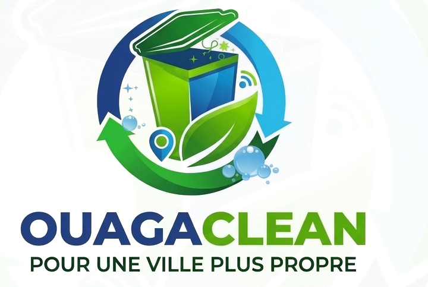
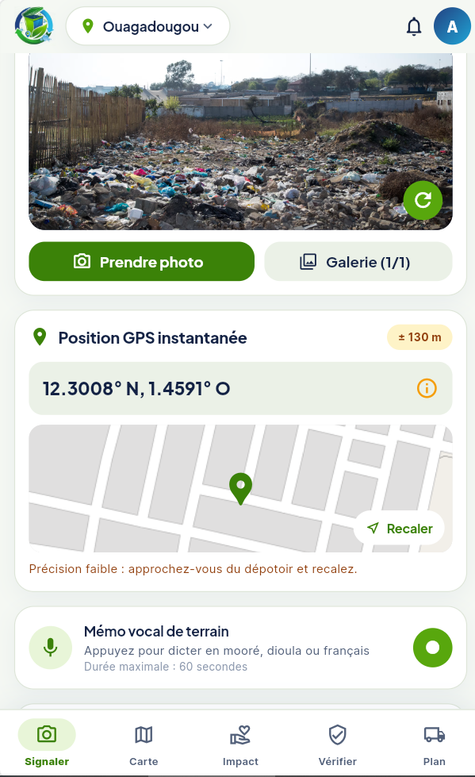
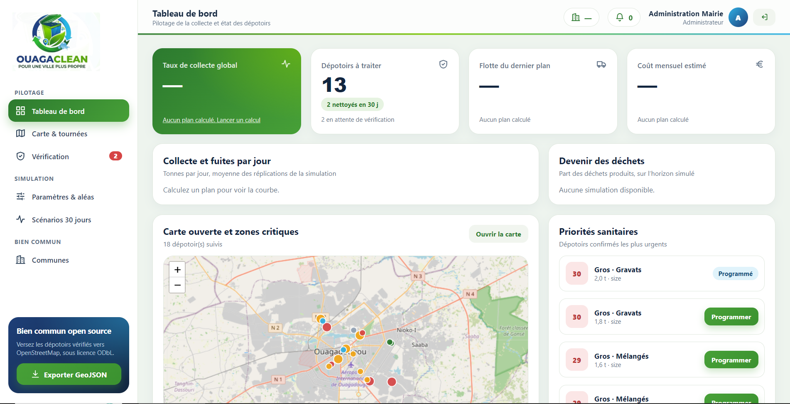
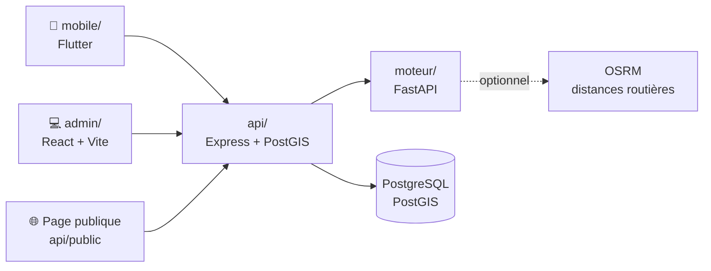

<p align="center">
  
</p>

# OuagaClean — Ouaga Assainissement

**Pour une ville plus propre.** Outil open source de signalement des dépotoirs, de planification de la collecte des déchets et de simulation de scénarios à Ouagadougou (Burkina Faso).

Projet du hackathon *Open Source*, défi « Assainissement de Ouagadougou ».

## Ce que fait le projet

- **Signaler** un dépotoir depuis un téléphone : photo, position GPS, taille, type de déchets, mémo vocal. L'envoi est différé si le réseau manque.
- **Valider** les signalements : règles anti-doublons et anti-fraude (photo réutilisée, GPS imprécis, déplacement impossible), puis un score de confiance qui monte avec le nombre d'auteurs distincts.
- **Prioriser** les dépotoirs selon un score sanitaire de 0 à 100 (taille, ancienneté, caniveaux, écoles, marchés, centres de santé).
- **Planifier** la collecte : points de regroupement, tournées de camions et de tricycles, rotations, pré-collecteurs.
- **Simuler** des scénarios sur 30 jours (pannes, saison des pluies, nouveau quartier, baisse de budget) et comparer les résultats avec une marge d'incertitude.
- **Ouvrir les données** : export GeoJSON, CSV et OpenStreetMap (ODbL) des dépotoirs vérifiés.

## Aperçu

| Application mobile | Interface d'administration |
|---|---|
|  |  |
| **Signaler** un dépotoir : photo, position GPS, mémo vocal | **Tableau de bord** : collecte, carte des dépotoirs, priorités sanitaires |

## Architecture



L'API est le point d'entrée unique : le mobile et l'admin ne parlent jamais directement au moteur.

| Dossier | Rôle | Technologies | Documentation |
|---|---|---|---|
| [`moteur/`](moteur/) | Calcul : placement, tournées, simulation, priorité, analyse de photos, repérage satellite | Python 3.11, FastAPI, OR-Tools | [moteur/README.md](moteur/README.md) |
| [`api/`](api/) | Comptes, signalements, validation, dépotoirs, plans, notifications, données ouvertes | Node 20, Express, PostgreSQL 14+ / PostGIS | [api/README.md](api/README.md) |
| [`mobile/`](mobile/) | Application des citoyens, agents et vérificateurs | Flutter | [mobile/README.md](mobile/README.md) |
| [`admin/`](admin/) | Interface d'administration : tableau de bord, carte, vérification, paramètres, simulation, communes | React 18, Vite, Recharts, Leaflet | [section Administration](#administration) |

## Démarrage rapide

### Avec Docker (API, base et moteur ensemble)

```bash
cd api
export JWT_SECRET="$(openssl rand -hex 32)"   # PowerShell : $env:JWT_SECRET = -join ((48..57)+(97..102) | Get-Random -Count 40 | % {[char]$_})
docker compose up --build
docker compose exec api node scripts/seed-demo.js
```

L'API répond sur http://localhost:3000 et le moteur sur http://localhost:8000/docs.

### Sans Docker

Prérequis : Node 20+, Python 3.11+, PostgreSQL 14+ avec l'extension PostGIS.

```bash
# 1. Moteur (port 8000)
cd moteur
python -m venv .venv && source .venv/bin/activate    # Windows : .\.venv\Scripts\Activate.ps1
pip install -r requirements.txt
uvicorn app.main:app --reload --port 8000

# 2. API (port 3000), dans un autre terminal
cd api
cp .env.example .env        # Windows : copy .env.example .env
npm install
npm run migrate
npm run seed
npm run dev
```

Renseigner dans `api/.env` : `DATABASE_URL`, `JWT_SECRET` (32 caractères minimum), `ENGINE_URL=http://localhost:8000` et le même `ENGINE_API_KEY` que le moteur.

### Comptes de démonstration

Créés par `npm run seed`. Mot de passe pour les trois : `demo-2026`.

| Téléphone | Rôle |
|---|---|
| `+22670000001` | Administrateur |
| `+22670000002` | Vérificateur |
| `+22670000003` | Agent |

> Le seed crée aussi des bâtiments **synthétiques**. En production, importer les vrais bâtiments (Open Buildings) et les lieux sensibles OpenStreetMap, voir [api/DONNEES.md](api/DONNEES.md).

## Administration

L'interface d'administration est servie par l'API : après le démarrage, ouvrir **http://localhost:3000/admin/** et se connecter avec un compte administrateur ou vérificateur.

| Page | Contenu |
|---|---|
| Tableau de bord | Indicateurs de collecte, fuites vers les dépotoirs, dépotoirs prioritaires |
| Carte & tournées | Dépotoirs par statut, tournées du dernier plan |
| Vérification | File de modération des signalements, journal anti-pièges |
| Paramètres & aléas | Réglages du moteur, imprévus, comparaison de scénarios |
| Scénarios 30 jours | Simulation multi-agents animée du dernier plan |
| Communes | Configuration territoriale, export `config.json` |

**Modifier l'interface** (dossier `admin/`) :

```bash
cd admin
npm install
npm run dev        # http://localhost:5173/admin/ , appelle l'API sur le port 3000
npm run build      # produit admin/dist/
```

Après un `build`, copier le contenu de `admin/dist/` dans `api/public/admin/` pour que l'API serve la nouvelle version. Pour viser une autre API : `API_URL=http://hote:3000 npm run dev`.

Les couleurs viennent du logo (vert, bleu clair, bleu marine) et sont définies en haut de `admin/src/styles.css`.

## Application mobile

```powershell
cd mobile
flutter pub get
flutter run --dart-define=API_BASE=http://IP_DU_PC:3000
```

`IP_DU_PC` est l'adresse IPv4 donnée par `ipconfig` (téléphone et PC sur le même réseau). Émulateur Android : `http://10.0.2.2:3000`. Détails, écrans et langues dans [mobile/README.md](mobile/README.md).

## Variables d'environnement

| Variable | Où | Rôle |
|---|---|---|
| `DATABASE_URL` | api | Connexion PostgreSQL |
| `JWT_SECRET` | api | Secret de signature des sessions (32 caractères minimum) |
| `ENGINE_URL` | api | Adresse du moteur FastAPI |
| `ENGINE_API_KEY` | api et moteur | Clé partagée, en-tête `X-Engine-Key` |
| `UPLOAD_DIR` | api | Dossier des photos et mémos |
| `CORS_ORIGINS` | api et moteur | Origines autorisées (`*` en développement seulement) |
| `PUBLIC_BASE_URL` | api | Adresse publique de l'API |
| `OSRM_URL` | moteur | Distances routières réelles (sinon vol d'oiseau × coefficient de détour) |
| `USE_CLIP` | moteur | `1` active la vérification des photos par CLIP |
| `WHATSAPP_*` | api | Signalement par WhatsApp, voir [api/README.md](api/README.md) |

Ne jamais envoyer le fichier `.env` sur GitHub : il est dans `.gitignore`.

## Tests

```bash
cd moteur && pip install -r requirements-dev.txt && pytest -q
cd api && npm test                       # règles métier
cd api && npm run test:integration       # PostGIS et moteur requis, base ouaga_test
cd mobile && flutter test
```

## Données et licences

- Code : licence MIT.
- Fond de carte et données dérivées d'OpenStreetMap : © contributeurs OpenStreetMap, licence ODbL. Les exports de dépotoirs vérifiés sont publiés sous ODbL.
- Détails sur les sources et l'attribution : [api/DONNEES.md](api/DONNEES.md) et [moteur/DONNEES.md](moteur/DONNEES.md).

## État du projet et limites

Ce que le projet ne fait pas encore, ou ne fait qu'en partie :

- Les paramètres par défaut (déchets par personne, coûts, capacités, prix de revente) sont des **hypothèses de départ** à fixer avec la mairie. Le garage et la décharge sont des valeurs provisoires : chaque plan le signale tant qu'ils ne sont pas renseignés.
- Sans CLIP, l'analyse du contenu des photos est une heuristique peu fiable. Le repérage par image aérienne produit des **candidats à vérifier sur le terrain**, pas des certitudes.
- Le paiement d'abonnement Orange/Moov est **simulé**. Le raccordement WhatsApp réel à Meta n'a pas été essayé.
- Le mooré et le dioula de l'application mobile attendent la validation de locuteurs (voir `mobile/tool/traductions_a_valider.csv`).
- L'optimisation, la simulation et les règles ne sont pas de l'apprentissage automatique : seuls CLIP (optionnel) et l'apprentissage de la meilleure réponse à un aléa s'en approchent.

## Contribuer

1. Créer une branche : `git checkout -b ma-fonction`.
2. Lancer les tests du dossier modifié.
3. Ouvrir une *pull request* vers `main` en décrivant ce qui change.

Les contributions de traduction (mooré, dioula) et de données de terrain sont particulièrement bienvenues.

## Équipe

Équipe Ouaga Propre — dépôt maintenu par [@fatazeouedraogo](https://github.com/fatazeouedraogo).
